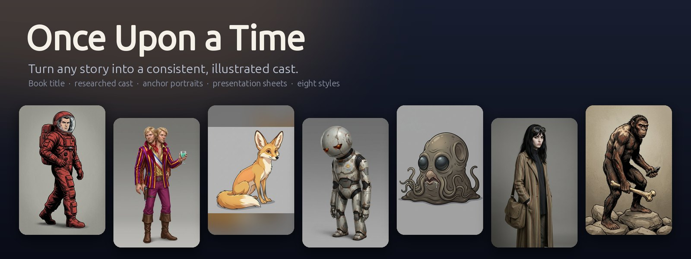
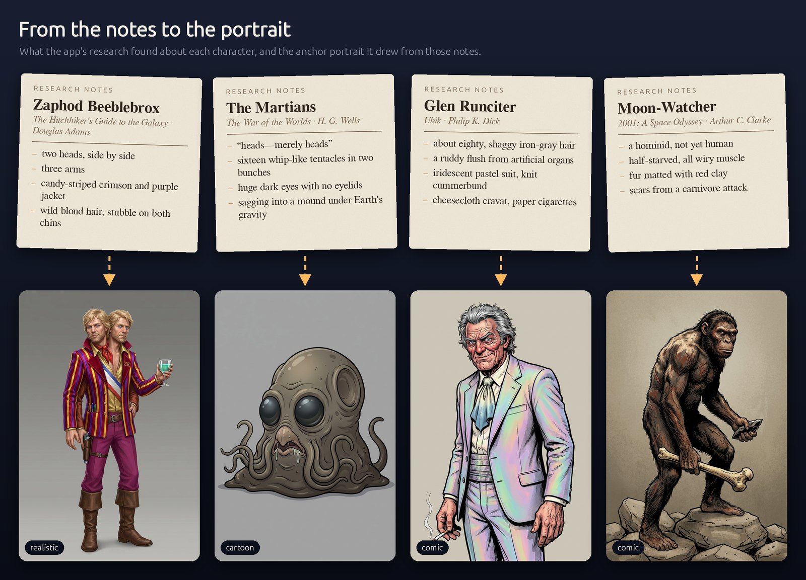
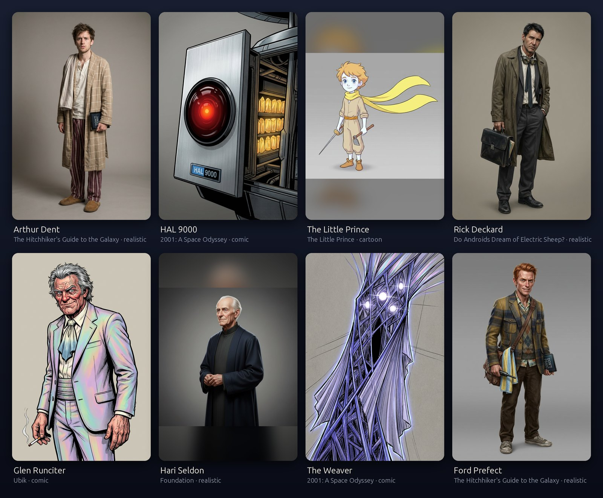
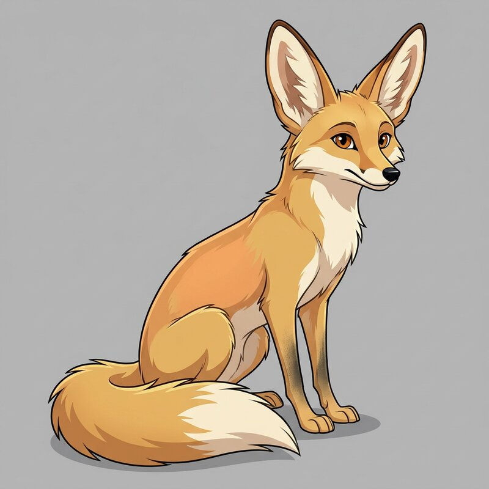
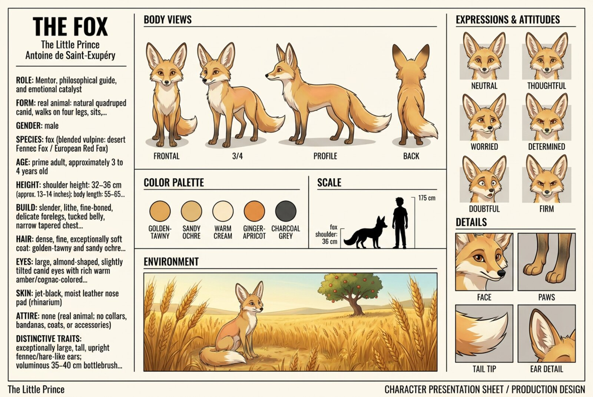
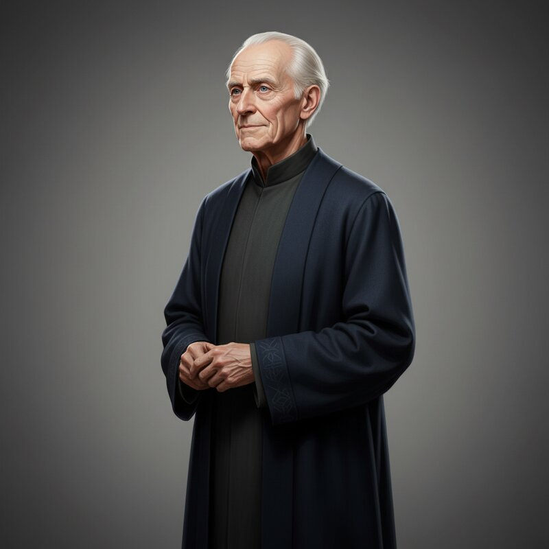
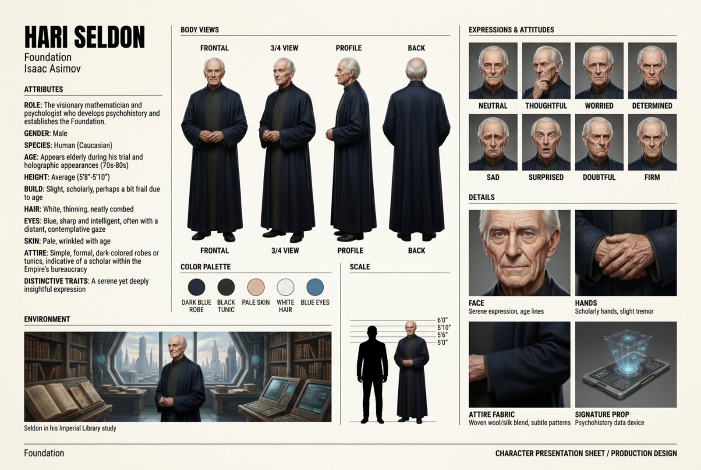
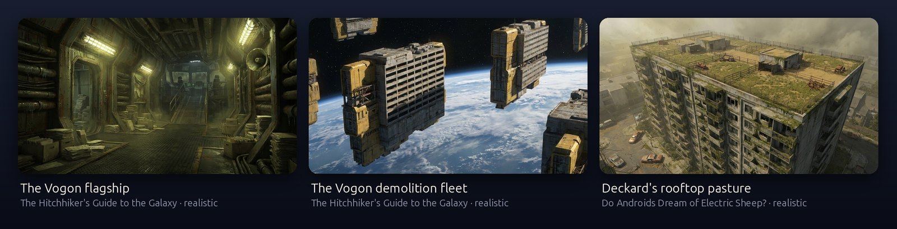
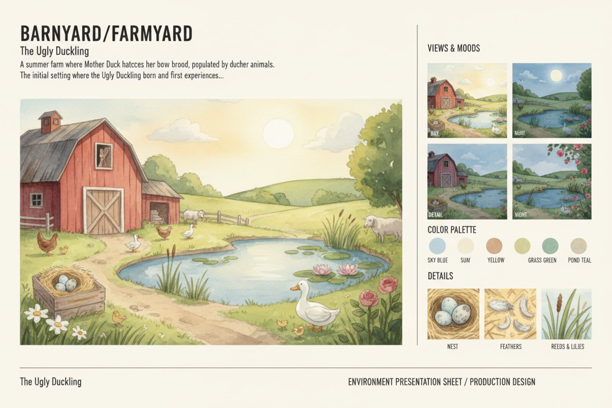

# 📖 Once Upon a Time

Turn any story into consistent illustrations of its characters, locations and key passages.

Give it a book title. It researches the book, builds a validated cast, and generates studio-style
character portraits and production-design sheets with Gemini, keeping every character the same
across every image.

## Why I built this

> *I always wanted to meet the characters the way the author wrote them.*

Every book I've loved left me with a cast I could almost see. Almost. A face would shift between
chapters. A creature the author spent a whole page describing would come out of my head as a vague
shape. A two-headed, three-armed galactic president never quite assembled. I wanted the most
faithful version possible, and sometimes my imagination just didn't get there.

So I built the companion I wanted next to me while reading. Give it a title and it goes looking for
every detail the book, and the people who have studied it, have to say about each character, writes
them into a sheet, and draws them. When the research leans on a film instead of the page, an
author's note pulls it back. Once a character has a face, it keeps it in every image that follows.

It doesn't replace your imagination. It gives it something solid to stand on.

## The cast so far

*Anchor portraits from six books in three of the eight styles. Every one of them started as a book
title typed into the app.*

## From anchor to presentation sheet

One anchor portrait per character; every later image uses it as a reference image, so the sheet
shows the same individual from every angle.

| Anchor portrait | Presentation sheet |
|---|---|
|  |  |
|  |  |

The Fox from *The Little Prince* (cartoon, and still a real fox) and Hari Seldon from *Foundation*
(realistic).

## Locations too

An establishing shot per location, then an environment sheet with views, moods, palette and details.

## What you get

- **A researched cast.** Characters, locations and key passages gathered from the web and validated
  against a strict schema. Nothing is invented: unknown fields stay `undefined`.
- **Faithful characters.** A talking fox is still a fox. If the research gets something wrong, write
  an author's note on the character and regenerate.
- **Consistent images.** One anchor portrait per character; every other image uses it as a
  reference, so identity never drifts.
- **Eight styles.** Cartoon, realistic, retro, anime, watercolor, comic, pixel-art, noir.
- **A PDF of the whole project**, and a running estimate of what every call cost.

## Try it

The [setup guide](docs/setup.md) gets it running on your machine in a few minutes. Then create a
project, type the title of a book you love, and press **Research book**.

## Learn more

- [Setup](docs/setup.md): what you need, running it, configuration, troubleshooting.
- [User guide](docs/usage.md): your first book, author's notes, PDF export, costs, roadmap.
- [Architecture](docs/architecture.md): modules, data layout, pipelines, design decisions.
- [Original spec](docs/once-upon-a-time-spec.md).

Built with Streamlit, Pydantic and Gemini. Ships Claude Code skills in `.claude/skills/` for
running, inspecting and documenting the project.
