# Gallery

Six books, each illustrated end to end in one style: the cast first, then a presentation sheet
beside a location. Every book started as a title typed into the app.

## One Hundred Years of Solitude

*Gabriel García Márquez* · style: **pencil**

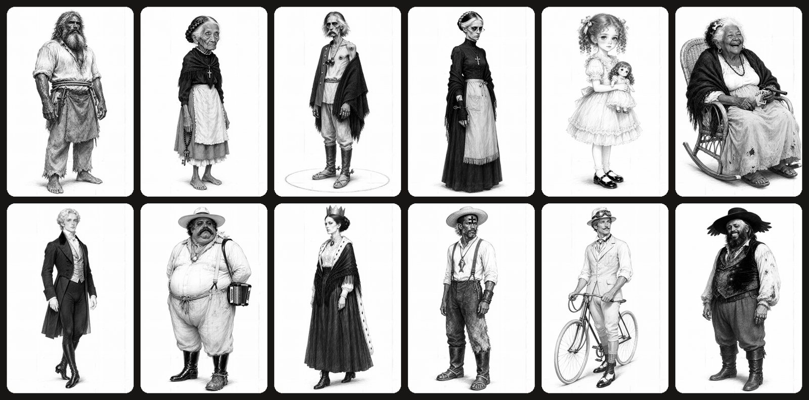
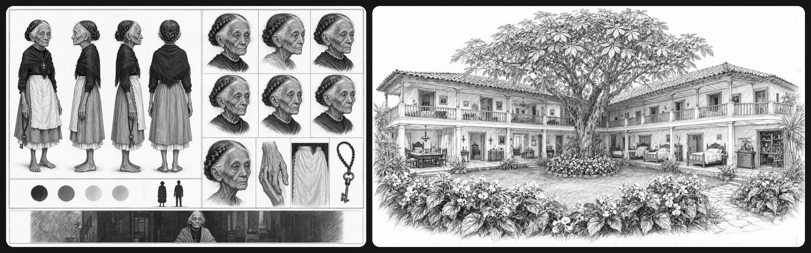

## The War of the Worlds

*H. G. Wells* · style: **80s comic**

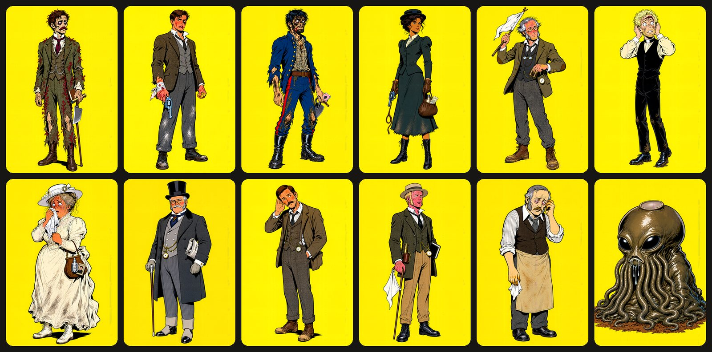
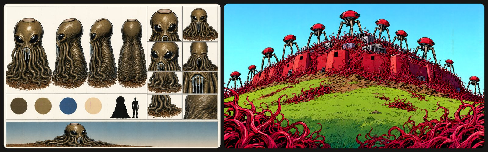

## Death's End

*Liu Cixin* · style: **realistic**

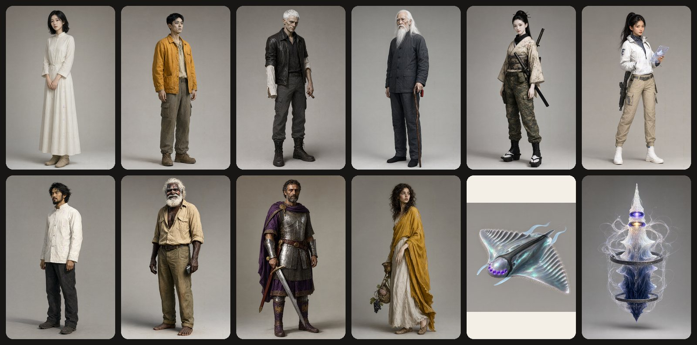
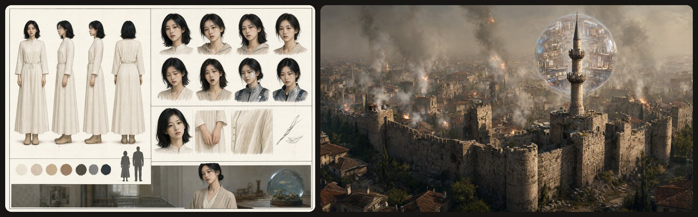

## 2001: A Space Odyssey

*Arthur C. Clarke* · style: **comic**

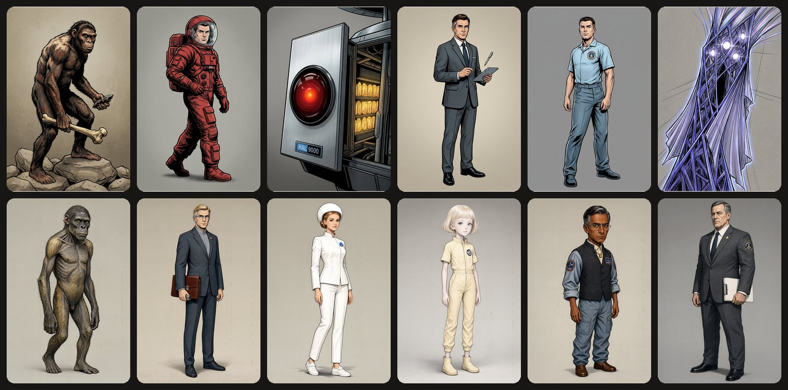
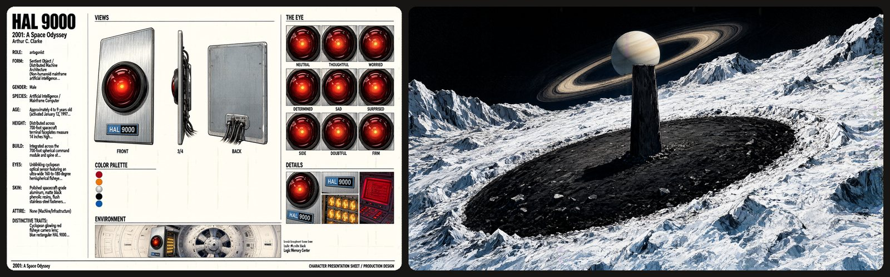

## Do Androids Dream of Electric Sheep?

*Philip K. Dick* · style: **realistic**

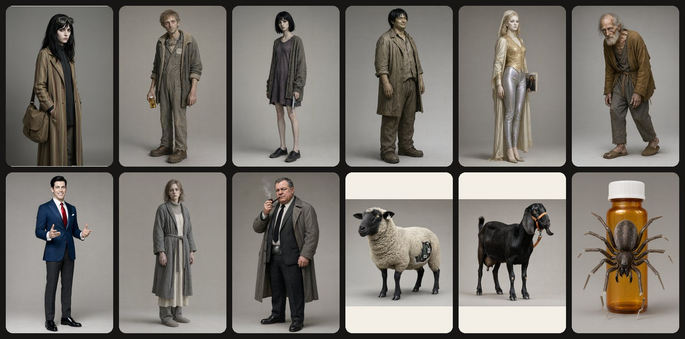
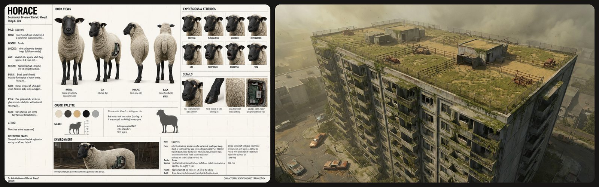

## The Hitchhiker's Guide to the Galaxy

*Douglas Adams* · style: **realistic**

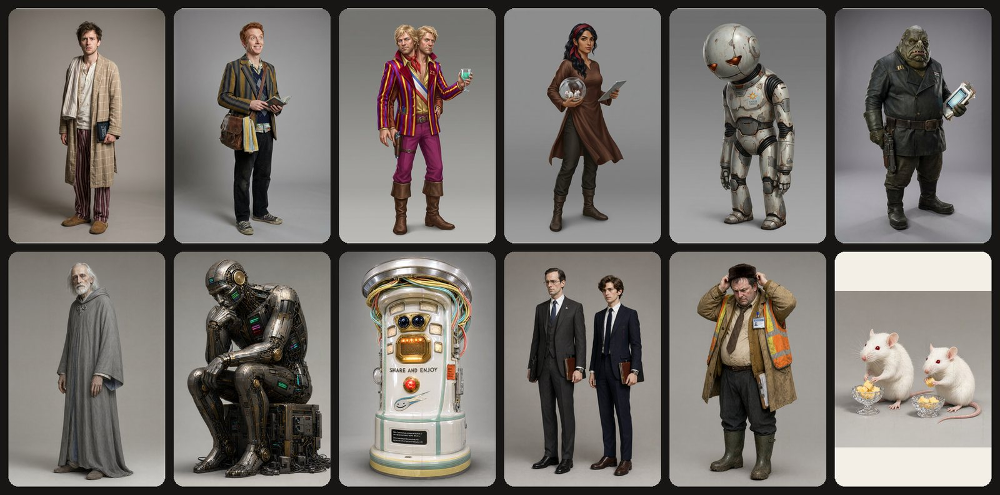
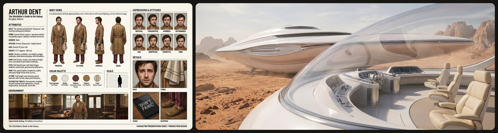
