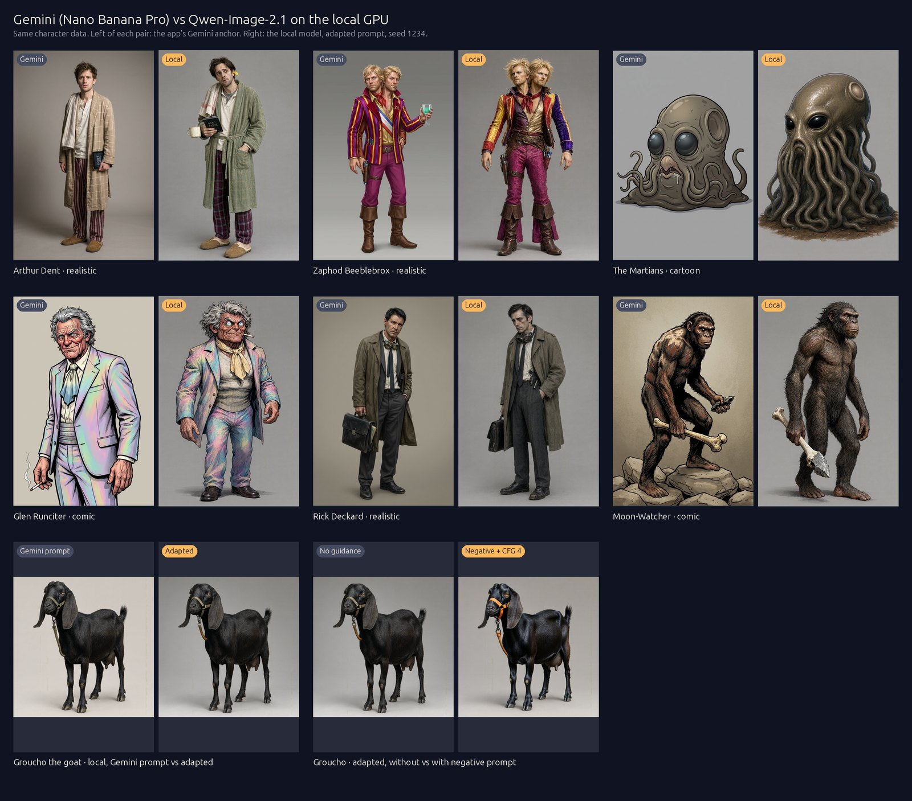
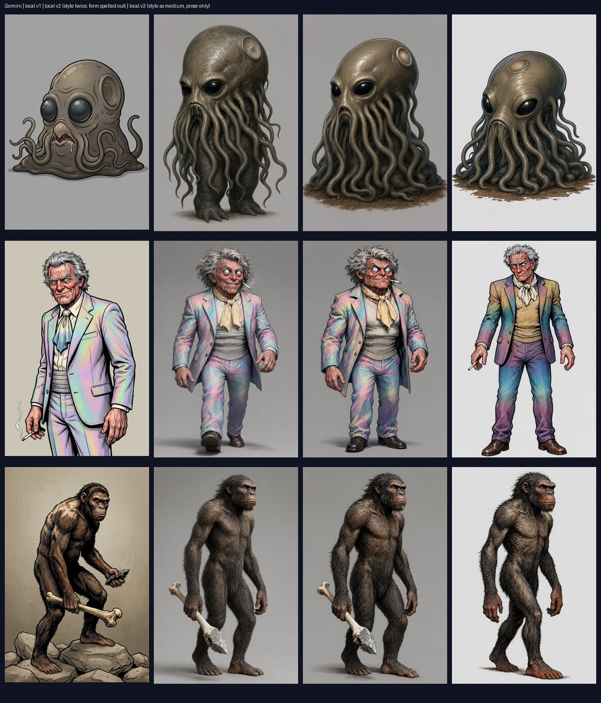
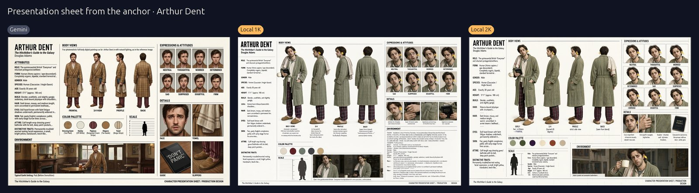

# Local GPU images: evaluation

How images generated on a local GPU with Qwen-Image-2.1 compare with Gemini (Nano Banana Pro)
for the same researched characters, and why the local backend works the way it does. To set it
up, see [Images on your own GPU](setup.md#images-on-your-own-gpu).

## Summary

- **Realistic portraits are on par with Gemini.** Arthur Dent, Rick Deckard, Zaphod Beeblebrox
  (two heads) and Groucho the goat follow their sheets as faithfully as Gemini's, in about
  25 seconds and at no API cost. Arthur even gets the Babel fish in his ear, which Gemini left out.
- **Cartoon and comic styles drift towards realism.** Prompt changes help only partly;
  per-style tuning works for `comic` and `80s-comic` (see [80s comic](#80s-comic)).
- **Presentation sheets keep the identity but not the small text.** At the native 2K the layout,
  headers, attribute column and expression labels are mostly legible; captions are not. Local
  sheets are therefore drawn as wordless art-book plates (see [Sheets](#sheets-without-text)).
- **Research stays on Gemini.** Local models do not search the web.

Gemini remains the default image backend; switching is one setting.

## Setup

| Item | Value |
|---|---|
| Model | [Qwen-Image-2.1](https://huggingface.co/Qwen/Qwen-Image-2.1), released 2026-09-20 |
| Weights | 33.1 GB bf16: Qwen3-VL text encoder 17.5 GB, transformer 14.2 GB, VAE 1.4 GB |
| License | Qwen Research License: research and non-commercial use only |
| GPU | RTX 5090, 32 GB, driver 580, CUDA 12.8 wheels |
| Software | torch 2.11.0+cu128, diffusers 0.43.0.dev0 (pinned commit of main), transformers 5.22.2 |
| Memory strategy | Model CPU offload: the weights do not fit in 32 GB at once |
| Sampling | 40 steps, no guidance (the model's default), seed 1234 |

## Measurements

| Image | Size | Time | Peak VRAM |
|---|---|---|---|
| Anchor portrait | 832×1248 | 25 s | 18 GB |
| First image after a restart | 832×1248 | 32–48 s | 18 GB |
| Presentation sheet, anchor as reference | 1248×832 | 68 s | 20.5 GB |
| Presentation sheet, anchor as reference | 2528×1696 | 103–115 s | 21 GB |
| Anchor with negative prompt (guidance 4) | 1024×1024 | 41 s | 18 GB |

Cost per image: $0 in the usage log, against about $0.13–0.18 with Gemini. The first start
downloads the 33 GB of weights (about 7 minutes on this connection) into a Docker volume.

## What the comparison showed



- **Prompt rules.** The app's Gemini prompt is half description, half rules written as
  negations ("NO clothing", "no text"). Sent unchanged, the local model still produced a clean,
  single, unclothed goat: the negations did no visible harm. The local prompt states the
  composition positively anyway.
- **Negative prompt.** It only acts with guidance above 1, which costs 1.6× the time. On
  Groucho it only saturated the halter colour, so guidance stays off by default.
- **Form.** "In the natural posture of its form" put The Martians on legs. Spelling the form
  out ("a giant head with tentacles, unable to stand, sagging into a mound") fixed it.
- **Style.** Repeating the style at the end of the prompt did not bring cartoon or comic styles
  back. Phrasing the style as the kind of drawing and dropping the attribute list did (ink
  outlines on Glen Runciter), but lost details such as Moon-Watcher's bone tool. The app keeps
  the variant that preserves details.



- **Sheets.** The local model builds the full layout from the anchor and keeps the same face,
  robe and Babel fish in every panel. At 1K the attribute column is partly garbled; at 2K it is
  legible, but small labels still slip ("PRICILE" for PROFILE) and captions are noise. Sheets
  therefore render at 2K locally.



### Sheets without text

Even at 2K, long captions and attribute lines came out blurred or misspelled, and they only
repeat what the PDF prints beside each sheet. Since November 2026 the local backend asks for a
wordless plate instead: the same turnaround, expressions, palette swatches, scale silhouette,
close-ups and setting strip, on off-white paper with thin dividers, and no title, labels,
captions or numbers. The prompt names no section and quotes no words, because both invite the
model to write them. Tested on a human (Rick Deckard), a real animal (Groucho, who stays a goat
in every view) and a location; the only letters left are the ones on props, such as a book cover.
Gemini sheets keep their text, which Gemini renders cleanly.

### 80s comic

The `80s-comic` style (flat bright colors, clean even inks, solid black shadows, as in mainstream
American comics of the 1980s) was added for *The War of the Worlds*. With the regular local
portrait prompt it came out gritty and painterly: the gray studio background with soft lighting
and long descriptions of mud and torn clothes pulled it towards illustration realism, and a style
reference image did not help. Two changes did: a flat solid yellow background, like a comic panel,
and guidance with a negative prompt against realism (photorealistic, painterly, gritty texture,
muted colors, gradients). Both live in `LOCAL_STYLE_TUNING` in `app/core/imaging.py` and apply
only to that style, to portraits and location shots, at about 45 s per portrait instead of 27.
Sheets take the style from the portrait and run without guidance, which brings captions back.

The plain `comic` style got the same treatment for *Ubik*, with a flat pale blue panel background:
side by side with the regular local prompt it gave cleaner inks and flatter colors. Projects made
before (*2001: A Space Odyssey*) keep their images; only new comic images use it.

Both comic styles also ask for realistic adult proportions on human characters
(`COMIC_FIGURE`) and add caricature terms to the negative prompt. Philip K. Dick describes several
*Ubik* characters through grotesque metaphors (a body "like a bug in a cocoon", a nose "like the
rubber bulb of a taxi horn"), and the model drew those few as caricatures while the rest of the
cast kept normal proportions. The clause alone fixed most of them; the worst cases also needed a
plainer description, which is what an author's note on the character is for.

### Pencil

The `pencil` style (a detailed black-and-white graphite drawing on white paper) was added for
*One Hundred Years of Solitude*. Locations came out as clean pencil drawings at once, but
portraits came out as colored pencil: the descriptions name skin, eye and fabric colors in every
line, and neither the style clause nor guidance with a negative prompt against color stopped it.
The style therefore has local tuning (white paper background, guidance, anti-color negative) and
is listed in `MONOCHROME_STYLES`: every image of a pencil project is converted to grayscale
before it is saved, on both backends. In grayscale the same drawings read as graphite.

Two refinements came from *Death's End*. Singer, a manta-like alien, got human legs and hands
from the regular plate, as HAL 9000 had on the old sheet, so beings without a human body plan
get a creature plate (views of the whole being, close-ups of its sensory organs, no hands).
And Singer's research, full of quoted terms and lab vocabulary, kept coming back with small
labels, sometimes in Chinese: quotation marks are now stripped and the creature plate no longer lists
mood words, which the model copied as captions. Guidance with a no-text negative prompt did not
help (it made Singer's text worse) and costs 1.6x the time, so plates run without it. Most
characters come out with no text at all; a few still carry a short header line.

## Decisions this led to

| Finding | What the implementation does |
|---|---|
| The bf16 weights (33 GB) exceed 32 GB of VRAM | Model CPU offload; peak VRAM stays at 18–21 GB |
| The loaded model holds ~25 GB of RAM | The server unloads it after 20 idle minutes and reloads on demand |
| The model card omits `torchvision` | Installed next to torch; all versions pinned, diffusers to a tested commit |
| A 2K sheet ran out of VRAM in the VAE decode | Tiled VAE decoding |
| Output is RGBA with a noisy alpha (216–255 over 10–30 % of pixels) | The server returns RGB unless transparency is requested |
| Negative prompts need guidance (1.6× slower), with little gain | Guidance off; the local prompt states rules positively |
| Generic posture wording ignored the form | The local prompt spells the form out |
| Sheet text is only legible at 2K, and captions never are | Local sheets are wordless plates at 2K; portraits and locations use 1K |

## Next steps worth trying

1. **Style reference images.** The model accepts up to 10 references; a fixed example image per
   style, passed next to the anchor, may fix cartoon and comic where text does not.
2. **Qwen-Image-2.1-Turbo** (8 steps) for portraits, if quality holds at a fifth of the time.
3. **Per-project backend**, so realistic books go local and stylized ones stay on Gemini.
4. **FLUX.2 [dev]** as a second open model for the same comparison.

## Reproduce

```bash
./launch.sh gpu
docker compose exec -T app python - < local_image/compare.py   # writes data/local-gpu-eval/
python3 local_image/side_by_side.py --out docs/images            # comparison images
```
