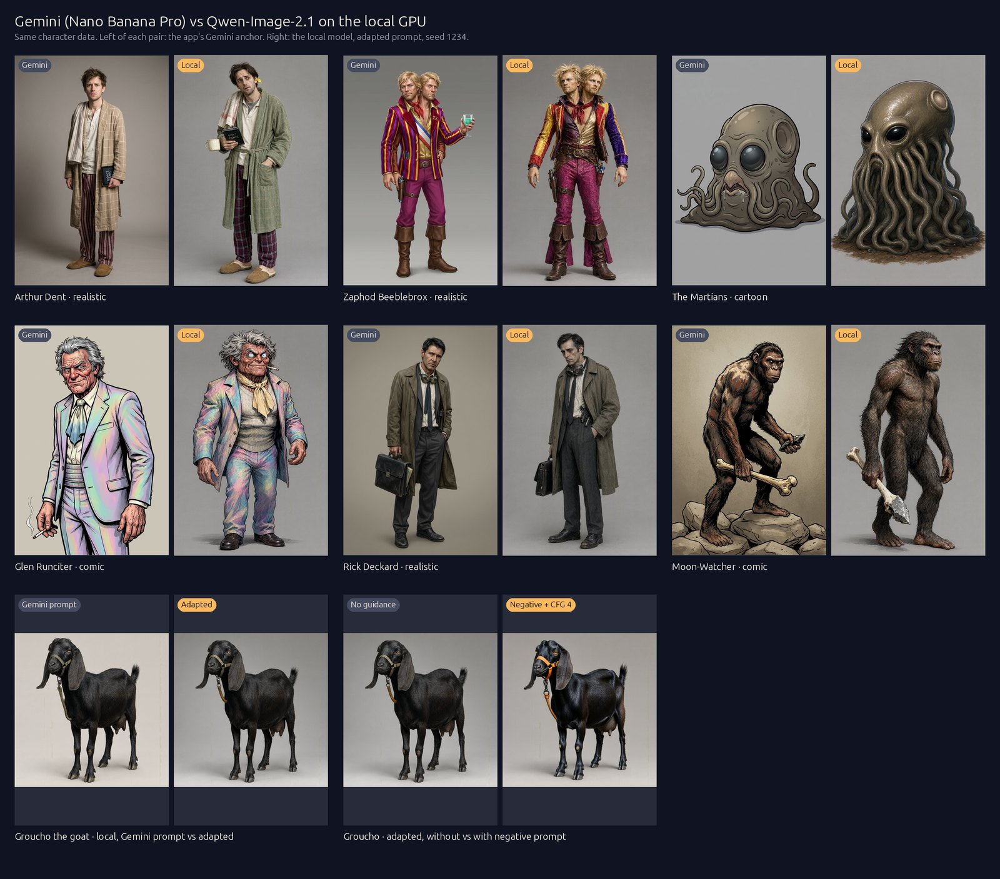
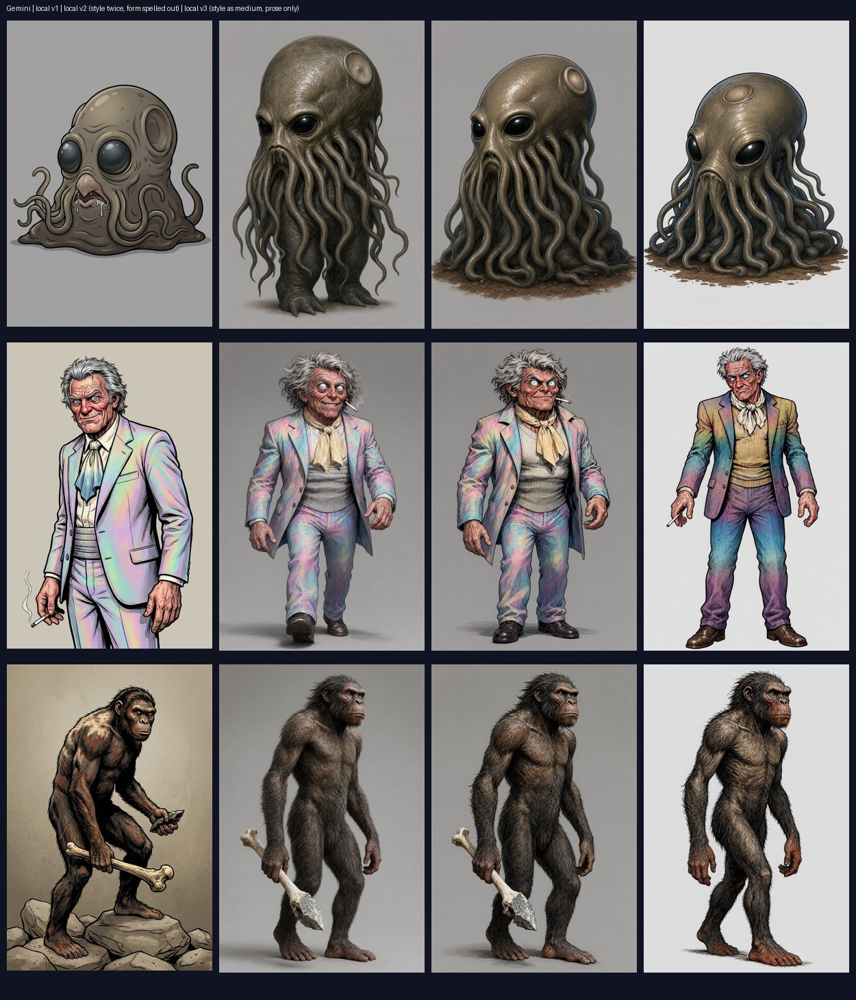
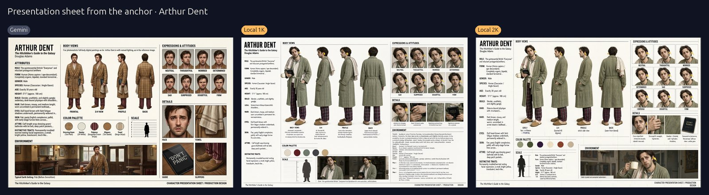

# Proof of concept: local image generation

Can Once Upon a Time generate its character images on the local GPU instead of Gemini
(Nano Banana Pro), from the same researched character data? This document records what was
built on the `poc/local-image-qwen` branch and what the comparison showed.

## Verdict

Yes, for realistic projects; not yet for stylized ones or for text-heavy sheets.

- **Realistic anchors are on par.** Arthur Dent, Rick Deckard, Zaphod Beeblebrox (two heads)
  and Groucho the goat follow their sheets as faithfully as Gemini's, in about 25 seconds and
  at no API cost. Arthur even gets the Babel fish in his ear, which Gemini left out.
- **Cartoon and comic styles drift towards realism.** Prompt changes help only partly.
- **Sheets keep the identity but not the small text.** At the native 2K the layout, headers,
  attribute column and expression labels are mostly legible; captions and paragraphs are not.
- **Research stays on Gemini.** Local models do not search the web.

Gemini remains the default. The local backend is a setting, so a project can switch.

## Setup

| Item | Value |
|---|---|
| Model | [Qwen-Image-2.1](https://huggingface.co/Qwen/Qwen-Image-2.1), released 2026-09-20 |
| Weights | 33.1 GB bf16: Qwen3-VL text encoder 17.5 GB, transformer 14.2 GB, VAE 1.4 GB |
| License | Qwen Research License: research and non-commercial use only |
| GPU | RTX 5090, 32 GB, driver 580, CUDA 12.8 wheels |
| Software | torch 2.11.0+cu128, diffusers 0.43.0.dev0 (main), transformers 5.22.2 |
| Memory strategy | model CPU offload: the weights do not fit in 32 GB at once |
| Sampling | 40 steps, no guidance (the model's default), seed 1234 |

## Measurements

| Image | Size | Time | Peak VRAM |
|---|---|---|---|
| Anchor portrait | 832×1248 | 25 s | 18 GB |
| First image after a restart | 832×1248 | 32–48 s | 18 GB |
| Presentation sheet, anchor as reference | 1248×832 | 68 s | 20.5 GB |
| Presentation sheet, anchor as reference | 2528×1696 | 103–115 s | 21 GB |
| Anchor with negative prompt (guidance 4) | 1024×1024 | 41 s | 18 GB |

Cost per image: $0 in the usage log, against about $0.13–0.18 with Gemini. The first start
downloads the 33 GB of weights (about 7 minutes here) into a Docker volume.

## What the comparison showed



- **Prompt rules.** The app's Gemini prompt is half description, half rules written as
  negations ("NO clothing", "no text"). Sent unchanged, the local model still produced a
  clean, single, unclothed goat: the negations did no visible harm. The local prompt states
  the composition positively anyway.
- **Negative prompt.** It only acts with guidance above 1, which costs 1.6× the time. On
  Groucho it only saturated the halter colour, so it stays off.
- **Form.** "In the natural posture of its form" put The Martians on legs. Spelling the form
  out ("a giant head with tentacles, unable to stand, sagging into a mound") fixed it.
- **Style.** Repeating the style at the end of the prompt did not bring cartoon or comic
  styles back. Phrasing the style as the kind of drawing and dropping the attribute list did
  (ink outlines on Glen Runciter), but lost details such as Moon-Watcher's bone tool. The
  code keeps the variant that preserves details.



- **Sheets.** The local model builds the full layout from the anchor and keeps the same face,
  robe and Babel fish in every panel. At 1K the attribute column is partly garbled; at 2K it
  is legible, but small labels still slip ("PRICILE" for PROFILE) and captions are noise.
  Sheets therefore render at 2K locally.



## What was built

- `local_image/`: a FastAPI server around the diffusers pipeline (`server.py`), its
  Dockerfile, and the comparison scripts (`compare.py`, `side_by_side.py`).
- `docker-compose.yml`: an opt-in `local-image` service (profile `local-image`), GPU
  reservation, weights in the `local-image-models` volume, port bound to `127.0.0.1:8600`.
- `app/core/local_image.py`: the client; same contract as `gemini.generate_image`, logs each
  image as `qwen-image-2.1-local` at $0.
- `app/core/imaging.py`: `anchor_request` and `sheet_request` build each request, and
  `_generate_image` routes it by `IMAGE_BACKEND`. The local anchor prompt states rules
  positively, spells the form out and repeats the style. Sheets ask for 2K locally.
- Settings: an **Image backend** selector and the local server URL, with a health check on
  **Save & test**.

Problems found on the way, now handled: the model card omits `torchvision` (required by the
Qwen3-VL processor); a 2K sheet ran out of VRAM in the VAE decode until tiled decoding was
enabled; the model returns RGBA with a noisy alpha channel (values 216–255 over 10–30 % of
the pixels), so the server flattens to RGB unless transparency is requested.

An end-to-end run through the app's own functions (anchor, sheet, location) on a throwaway
project wrote all three images and logged three $0 entries; the project was then deleted.

## Next steps worth trying

1. **Style reference images.** The model accepts up to 10 references; a fixed example image
   per style, passed next to the anchor, may fix cartoon and comic where text does not.
2. **Qwen-Image-2.1-Turbo** (8 steps) for anchors, if quality holds at a fifth of the time.
3. **Per-project backend**, so realistic books go local and stylized ones stay on Gemini.
4. **FLUX.2 [dev]** as a second open model for the same comparison.

## Reproduce

```bash
docker compose --profile local-image up -d --build local-image
docker compose exec -T app python - < local_image/compare.py   # writes data/poc-local/
python3 local_image/side_by_side.py --out docs/images            # comparison images
```
