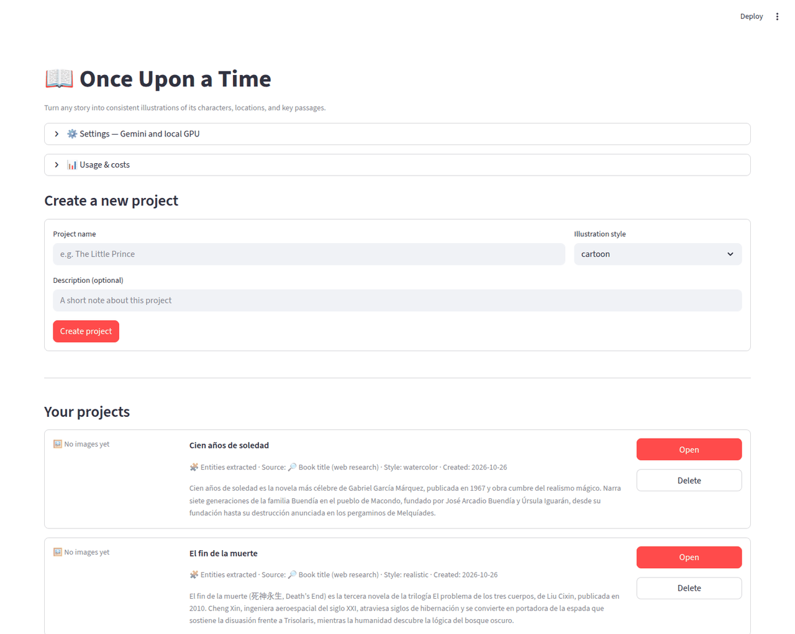

# Setup

How to install, configure and run Once Upon a Time, in the cloud or with images from your own
NVIDIA GPU. Once it is running, the [user guide](usage.md) walks you through your first book.

## Contents

1. [What you need](#what-you-need)
2. [Google Cloud and Vertex AI](#google-cloud-and-vertex-ai)
3. [Launch](#launch)
4. [Images on your own GPU](#images-on-your-own-gpu)
5. [Run without Docker](#run-without-docker)
6. [Configuration](#configuration)
7. [Troubleshooting](#troubleshooting)

## What you need

- Docker with the Compose plugin, or Python 3.12 to run without Docker.
- A Google Cloud project with billing active. Research and extraction always run on Gemini on
  Vertex AI; images too, unless you generate them on your GPU. The app shows a running estimate
  of the cost.
- The [gcloud CLI](https://cloud.google.com/sdk/docs/install).
- Optional: an NVIDIA GPU with 24 GB of VRAM or more (32 GB recommended) to generate images
  locally at no per-image cost. See [Images on your own GPU](#images-on-your-own-gpu).

## Google Cloud and Vertex AI

1. Enable the **Vertex AI API** on your project.
2. Give the account you will use the `roles/aiplatform.user` role on that project.
3. Log in with Application Default Credentials:

   ```bash
   gcloud auth application-default login
   ```

The app authenticates with those credentials; there are no API keys to create. With Docker, the
container mounts `~/.config/gcloud` read-only, so no credential file is copied into the image or
the repository.

## Launch

```bash
git clone https://github.com/JohnBetaCode/Once_Upon_a_Time.git
cd Once_Upon_a_Time
./launch.sh
```

`launch.sh` checks Docker and your Google credentials, then starts the app with Docker Compose.
When the machine has an NVIDIA GPU that can run the local image model, it starts the local GPU
image server too; otherwise it says why and images come from Gemini. It ends by printing the
addresses to open, including the ones for other devices on your network.

| Command | What it does |
|---|---|
| `./launch.sh` | Start the app, plus the local GPU server when this machine can run it |
| `./launch.sh cloud` | Start the app only |
| `./launch.sh gpu` | Start the app and the local GPU server, or explain why the GPU cannot run it |
| `./launch.sh status` | Containers, health, local GPU server state (including download progress) and URLs |
| `./launch.sh stop` | Stop everything; projects, settings and downloaded weights are kept |
| `./launch.sh logs [app\|gpu]` | Follow the logs of the app or of the GPU server |

Both containers restart on their own after a reboot. The plain Compose equivalents are
`docker compose up -d --build` for the app and, for the app plus the GPU server,
`docker volume create local-image-models` (once) and `docker compose --profile gpu up -d --build`.

Open http://localhost:8501. On first launch the **⚙️ Settings** panel is expanded: enter your GCP
project ID, keep the default models and locations unless you know otherwise, and click
**Save & test**. Settings are written to `config/.env`, which is git-ignored.



Code under `app/` is bind-mounted and hot-reloads. Rebuild only after changing
`requirements.txt` or the `Dockerfile`.

> **Keep it private.** The app has no login of its own, and Compose publishes port 8501 on every
> network interface. Anyone who can reach that port can generate images billed to your project and
> read the project ID in Settings. Use it on your machine, your home network or a VPN, and never
> expose the port to the internet. The local GPU server only listens on `127.0.0.1`.

## Images on your own GPU

Instead of Gemini, images can come from [Qwen-Image-2.1](https://huggingface.co/Qwen/Qwen-Image-2.1),
an open-weights model that runs on your NVIDIA GPU. It generates and edits in one model and accepts
reference images, so the anchor-to-sheet consistency works the same way. Research and extraction
still use Gemini. Local images cost nothing beyond electricity; the usage panel logs them at $0.

| Requirement | Detail |
|---|---|
| GPU | NVIDIA with at least 24 GB of VRAM; 32 GB recommended. Tested on an RTX 5090 |
| Driver and Docker | NVIDIA driver 570 or newer and the [NVIDIA Container Toolkit](https://docs.nvidia.com/datacenter/cloud-native/container-toolkit/latest/install-guide.html) |
| Memory | About 40 GB of RAM; the loaded model holds about 25 GB |
| Disk | About 45 GB free where Docker stores its data: 33 GB of weights and the server image |
| License | [Qwen Research License](https://huggingface.co/Qwen/Qwen-Image-2.1): research and non-commercial use |

**Start it.** `./launch.sh` starts the GPU server automatically when these requirements are met;
`./launch.sh gpu` insists and tells you what is missing. The first start builds the server image
and downloads the 33 GB of weights once, which takes a few minutes on a fast connection.
`./launch.sh status` shows the progress. The weights survive rebuilds and are shared with other
projects that run this server, such as [Colorín Colorado](https://github.com/JohnBetaCode/Colorin_Colorado);
see [where the models live](#where-the-models-live) below.

**Use it.** In **⚙️ Settings**, set **Image backend** to **Local GPU** and click **Save & test**.
The panel then shows the server's state. Switch back to **Cloud** at any time; nothing else
changes, and existing images stay as they are.

**What to expect** on an RTX 5090:

| Image | Size | Time |
|---|---|---|
| Character portrait or location shot | 832×1248, 1376×768 | about 25 s |
| Presentation sheet, from the portrait | 2528×1696 | about 105 s |
| First image after the model was unloaded | | a few seconds more |

Realistic projects come out close to Gemini. Cartoon and comic styles drift towards realism, and
the small captions on presentation sheets are often garbled; sheets render at the native 2K so
their headers and attributes stay legible. The [evaluation](local-gpu-evaluation.md) has the
side-by-side comparison.

**Memory.** After 20 minutes without requests the server unloads the model and frees its RAM;
the next image loads it again. Change this with `LOCAL_IMAGE_IDLE_MINUTES` (0 keeps it loaded).

### Where the models live

The weights go in one Docker volume, `local-image-models`, shared by
every project that runs this server (Once Upon a Time and Colorín Colorado), so each model
downloads once per computer. By default Docker keeps it in its own storage
(`/var/lib/docker/volumes/local-image-models` on Linux). To keep the models in a folder of your
choice, on another disk or somewhere you back up, set `LOCAL_IMAGE_MODELS_DIR` in `config/.env`
(or in your environment) before the first `./launch.sh`; the launcher creates the volume on that
folder. The first project that creates the volume decides where it lives, so set the same value in
every project; if they disagree, `launch.sh` says where the weights really are. `./launch.sh status`
shows the location. The volume is external to Compose, so `docker compose down -v` never deletes it.

To move weights you already downloaded into a folder:

```bash
./launch.sh stop                                    # in every project that runs the GPU server
mkdir -p /data/models
docker run --rm -v local-image-models:/src -v /data/models:/dst alpine cp -a /src/. /dst/
docker volume rm local-image-models
echo "LOCAL_IMAGE_MODELS_DIR=/data/models" >> config/.env   # in every project
./launch.sh gpu
```

The server runs as root in its container, so the files it writes in that folder belong to root.
To free the space, stop every GPU server, run `docker volume rm local-image-models`, and delete the
folder if you set one.

## Run without Docker

The app:

```bash
python3.12 -m venv .venv && source .venv/bin/activate
pip install -r requirements.txt
streamlit run app/main.py
```

The PDF export uses DejaVu Sans when it is installed (`fonts-dejavu-core` on Debian/Ubuntu) and
falls back to Helvetica otherwise.

The local GPU server, in its own environment:

```bash
cd local_image
python3.12 -m venv .venv && source .venv/bin/activate
pip install torch==2.11.0 torchvision==0.26.0 --index-url https://download.pytorch.org/whl/cu128
pip install -r requirements.txt
uvicorn server:app --host 127.0.0.1 --port 8600
```

Then set **Local GPU server URL** to `http://localhost:8600` in Settings.

## Configuration

Everything lives in `config/.env`. The Settings panel edits the app's keys and keeps every other
line of the file. The app reads the file at start-up; the local GPU server reads it when its
container starts, so restart that service after changing a `LOCAL_IMAGE_*` value:
`docker compose --profile gpu up -d local-image`.

| Variable                 | Default (`.env.example`) | Purpose                                                      |
|--------------------------|--------------------------|--------------------------------------------------------------|
| `GOOGLE_CLOUD_PROJECT`   | (required)               | GCP project that hosts Vertex AI and gets billed             |
| `GOOGLE_CLOUD_LOCATION`  | `global`                 | Region for the text model (research and extraction)          |
| `GEMINI_IMAGE_LOCATION`  | `global`                 | Region for the image model                                   |
| `GEMINI_TEXT_MODEL`      | `gemini-3.8-flash`       | Model for web research and structured extraction             |
| `GEMINI_IMAGE_MODEL`     | `gemini-3-pro-image`     | Image model (supports reference images for consistency)      |
| `IMAGE_BACKEND`          | `gemini`                 | Where images are generated: `gemini` (cloud) or `local` (GPU)|
| `LOCAL_IMAGE_URL`        | `http://local-image:8000`| The local GPU server as seen from the app                    |

Local GPU server (all optional):

| Variable                   | Default               | Purpose                                                        |
|----------------------------|-----------------------|----------------------------------------------------------------|
| `LOCAL_IMAGE_MODEL`        | `Qwen/Qwen-Image-2.1` | Hugging Face model id. `Qwen/Qwen-Image-2.1-Turbo` exists but is untested here; pair it with 8 steps |
| `LOCAL_IMAGE_STEPS`        | `40`                  | Sampling steps per image                                       |
| `LOCAL_IMAGE_SIZE`         | `1k`                  | Default size: `1k` (fast) or `2k` (native). Sheets always ask for `2k` |
| `LOCAL_IMAGE_IDLE_MINUTES` | `20`                  | Unload the model after this idle time; `0` keeps it loaded     |
| `LOCAL_IMAGE_PRELOAD`      | `1`                   | Load the model at start-up (`1`) or on the first image (`0`)   |
| `LOCAL_IMAGE_CFG`          | `1.0`                 | Guidance; above 1 enables the negative prompt at ~1.6x the time |
| `LOCAL_IMAGE_OFFLOAD`      | `model`               | `none` keeps the whole model on the GPU (needs ~40 GB of VRAM) |
| `LOCAL_IMAGE_MIN_VRAM_GB`  | `24`                  | The server refuses to start on GPUs with less VRAM             |
| `LOCAL_IMAGE_MODELS_DIR`   | Docker's storage      | Folder for the shared weights; read by `launch.sh` when it creates the `local-image-models` volume. Same value in every project |

## Troubleshooting

| Symptom | What to do |
|---|---|
| The page does not load | `./launch.sh status`, then `./launch.sh logs app`. A Python traceback at start-up points at the broken file. |
| "Google Cloud project is not configured" | Enter the project ID in **Settings** and click **Save & test**. |
| `DefaultCredentialsError`, 401 or 403 | Run `gcloud auth application-default login` again, check the Vertex AI API and the `roles/aiplatform.user` role, then `docker compose restart`. |
| 404 or "model not found" | The model name or location is wrong. Image models are usually served only from `global`. |
| 429 `RESOURCE_EXHAUSTED` | You hit the per-minute token quota. Wait a minute and research one book at a time; failed characters can be retried with **Deep research** on their card. |
| A portrait comes back empty | Usually the safety filter; the app already retries once. Reword the character with an author's note and regenerate. |
| You edited `config/.env` and nothing changed | Settings are loaded at start-up: `docker compose restart`, and `docker compose --profile gpu up -d local-image` for `LOCAL_IMAGE_*`. |
| `launch.sh`: "Docker cannot use the GPU" | Install the NVIDIA Container Toolkit, run `sudo nvidia-ctk runtime configure --runtime=docker`, then `sudo systemctl restart docker`. |
| "The local GPU server is not reachable" | Start it with `./launch.sh gpu`; if it is running, read `./launch.sh logs gpu`. |
| "downloading the model weights" | The first start is fetching 33 GB; `./launch.sh status` shows the progress. |
| "needs at least 24 GB" (unsupported) | This GPU is too small for the model; keep the **Cloud** image backend. |
| "the GPU ran out of memory" | Another program is using the GPU (a game, another model). Close it and try again. |
