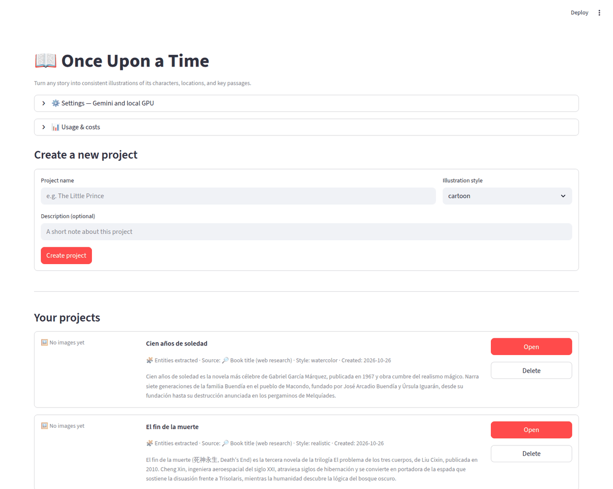
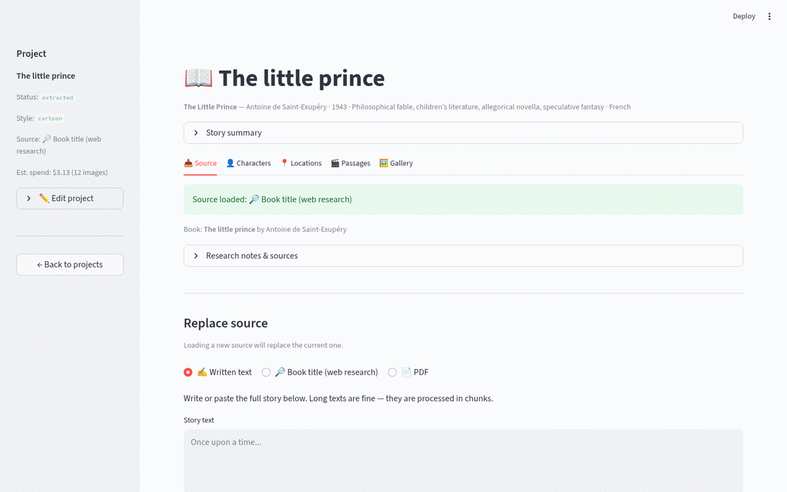
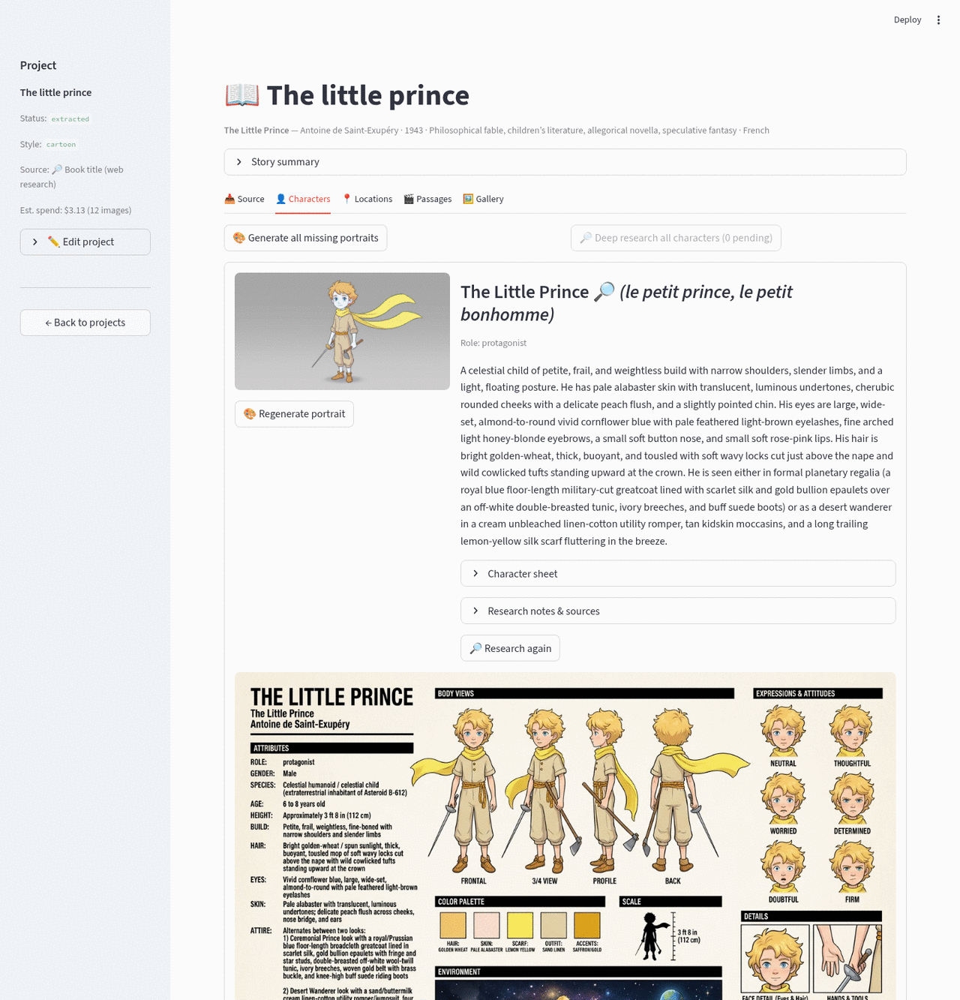
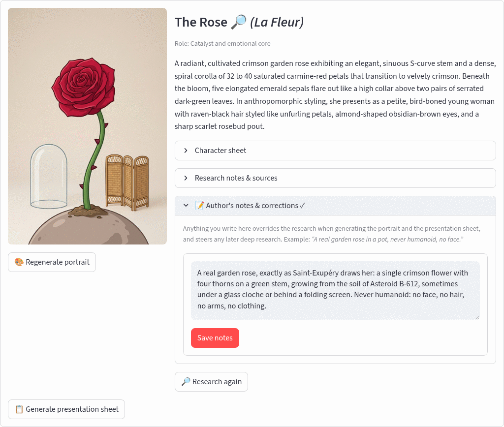
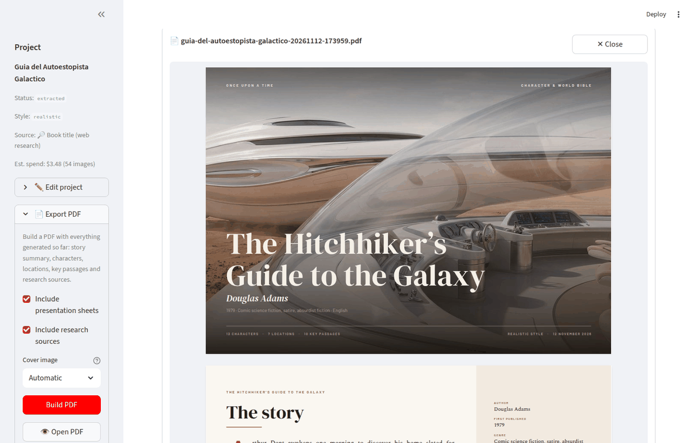
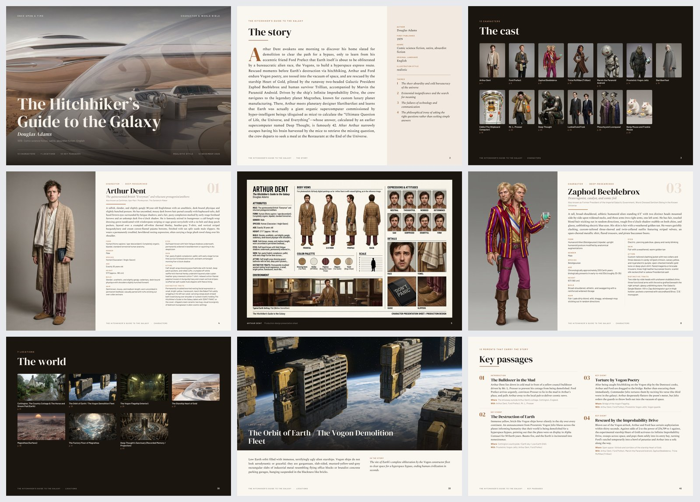
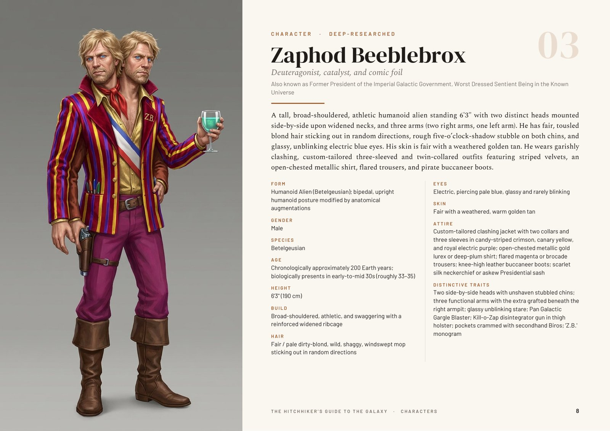
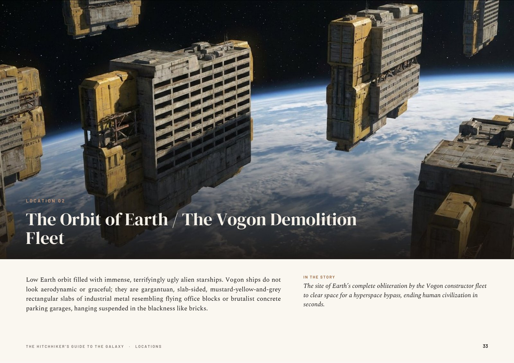
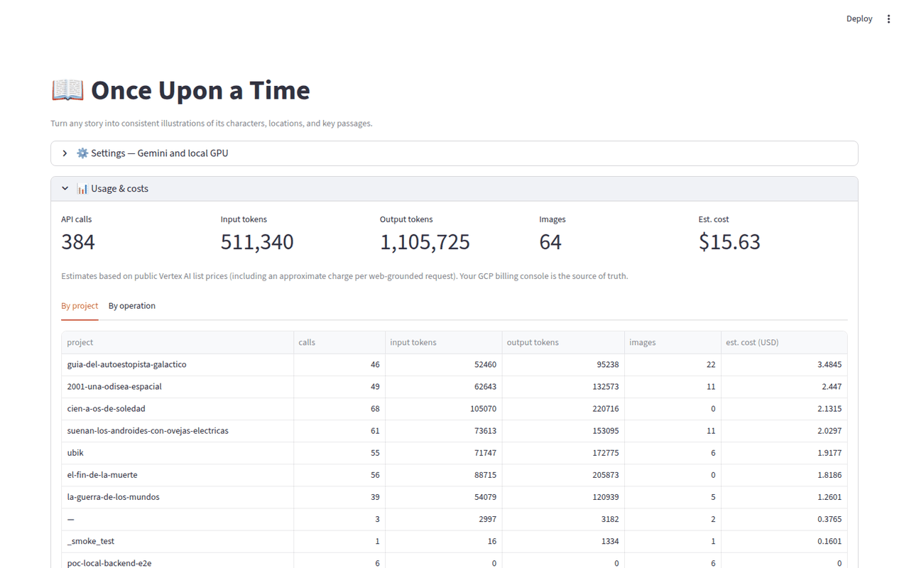

# User guide

How to use Once Upon a Time, from a book title to a finished PDF. To install and configure it, see
[setup.md](setup.md); for how it is built, see [architecture.md](architecture.md).

## Contents

1. [Your first project](#your-first-project)
2. [Correcting a character with author's notes](#correcting-a-character-with-authors-notes)
3. [Exporting a PDF](#exporting-a-pdf)
4. [Costs](#costs)
5. [Where your data lives](#where-your-data-lives)
6. [Status and roadmap](#status-and-roadmap)
7. [Working on the repo with Claude Code](#working-on-the-repo-with-claude-code)

## Your first project

The home page lists your projects. Each one shows a thumbnail collage of the images generated so
far (character portraits first, then locations), rebuilt automatically whenever those images change.



1. **Create a project** on the home page and pick an illustration style: `cartoon`, `realistic`,
   `retro`, `anime`, `watercolor`, `comic`, `80s-comic`, `pencil`, `pixel-art` or `noir`. The style applies to every image
   of the project; you can change it later from the sidebar (new generations only).
2. In the **Source** tab choose *Book title*, type the title (author optional) and click
   **Research book**. A web-grounded agent gathers the plot, cast, locations and key passages, then
   a second call converts the notes into validated JSON. Leave *Deep-research each character* on for
   much richer character sheets (a couple of minutes for the book, then about a minute per
   character; a 25-character novel takes roughly half an hour).

   

3. In **Characters**, click **Generate all missing portraits**. Each character gets one front-facing
   *anchor* portrait. Then click **Generate presentation sheet** on the characters you care about:
   the sheet (turnaround, expressions, palette, scale, details, environment) uses the anchor as a
   reference image, so it shows the same individual. If you regenerate a portrait, the UI warns that
   its sheet is stale. Images come from Gemini, or from your own NVIDIA GPU when **Image backend**
   is set to **Local GPU** in Settings ([setup](setup.md#images-on-your-own-gpu)); the progress
   messages say which one is drawing. Gemini sheets carry a title, labels and short captions; on
   the local GPU, which garbles small type, the sheet is a wordless art-book plate with the same
   panels.

   

4. **Locations** works the same way: an establishing shot, then an environment sheet.
5. **Passages** lists the key moments with their cast and place. Scene illustration is planned.
6. **Gallery** shows every image in the project.
7. **📄 Export PDF** in the sidebar turns the project into an art book whenever you want one; see
   [Exporting a PDF](#exporting-a-pdf).

## Correcting a character with author's notes

Research is grounded in web sources and sometimes follows an adaptation rather than the book
(The Rose in *The Little Prince* came out humanoid). Open **📝 Author's notes & corrections** on the
character card, write what should be true, and save:

> A real garden rose, exactly as Saint-Exupéry draws her: a single crimson flower with four thorns
> on a green stem, growing from the soil of Asteroid B-612. Never humanoid: no face, no hair, no
> arms, no clothing.



The note is injected with top priority into the portrait and sheet prompts and into any later
"Research again" or deep research of that character, and it survives re-research. After saving,
regenerate the portrait, then the sheet. The card warns while the portrait is older than the note.

## Exporting a PDF

Open **📄 Export PDF** in the sidebar and click **Build PDF**. The project comes out as a landscape
art book, made to be read on screen and printable on A4.



| Option | What it does |
|--------|--------------|
| **Include presentation sheets** | Adds every character and location sheet as a full-page plate. Without them the same book has about half the pages and a third of the size. |
| **Include research sources** | Adds the appendix of web sources, grouped by character. |
| **Cover image** | Which location goes on the cover. *Automatic* takes the most colourful establishing shot. The option appears once a location has an image. |

The finished document opens in a viewer in the main area, where you can page through it, and
the sidebar keeps **👁️ Open PDF** and **⬇️ Download PDF** buttons for the latest export. Files are
saved under `projects/<slug>/exports/` with a timestamp and are never overwritten.

### What is in the book

| Pages | What they show |
|-------|----------------|
| Cover | The title over an establishing shot, with the author, the genre and what the book holds. |
| The story | The summary, with the book facts and themes in a side panel. |
| The cast, the world | One thumbnail per character and per location, with its page number. Each one is a link. |
| Characters | The portrait at full page height beside the role, the description, every attribute of the sheet and your author's notes. The presentation sheet follows as a full-page plate. |
| Locations | The establishing shot across the page over its description and its place in the story, then the environment sheet. |
| Key passages | The key moments in order, each with its type, summary, place and cast. |
| Research sources | The web sources behind the book and each character, as links. |



| A character | A location |
|---|---|
|  |  |

### Good to know

- **Each book has its own palette.** The accent colour and the dark pages are derived from the
  cover image, so changing the cover changes the look of the whole book.
- **You can export at any point.** Before any location is illustrated the cover lines up the first
  portraits; a character without a portrait gets its initials; a project with no images at all
  gets a table of contents instead of thumbnails.
- **Long texts are kept whole.** A character page sets its text slightly smaller to fit beside the
  portrait, and continues on the next page if that is not enough.
- **It is easy to move around.** Besides the linked thumbnails, the PDF outline (the bookmarks
  panel of your viewer) lists every character and location.
- **Names in other scripts.** Cyrillic, Greek, Chinese, Japanese and Korean are drawn with fallback
  fonts that the Docker image installs; see [setup](setup.md#troubleshooting) if they show as
  empty boxes.
- **Size and time.** A fully illustrated 13-character book (48 pages with every sheet) is about
  14 MB and takes a few seconds; no API calls are made.

## Costs

Estimates are computed from Vertex AI list prices in `app/core/usage.py` and shown in the
**Usage & costs** panel on the home page, per project and per operation. The GCP billing console
is the source of truth.



| Operation                       | What it costs, roughly                                   |
|---------------------------------|----------------------------------------------------------|
| Book research (title)           | one grounded request plus one extraction, a few cents    |
| Deep research per character     | one grounded request plus one extraction, $0.05-0.10     |
| Anchor portrait or sheet        | one image generation, about $0.13-0.20 per image         |
| Image on the local GPU          | free; logged at $0 as `qwen-image-2.1-local`             |
| PDF export                      | free                                                     |

Portraits and sheets for a 13-character book come to roughly $3-5 with Gemini, and nothing beyond
research on a local GPU.

## Where your data lives

Everything is plain files; there is no database. `projects/`, `data/` and `config/.env` are
git-ignored.

```
projects/the-little-prince/
  project.json                           status, style, source, book metadata
  source/research.md                     web research notes + sources
  characters/characters.json             validated character list (+ author's notes)
  characters/the-fox/anchor.png          anchor portrait
  characters/the-fox/sheet.png           presentation sheet
  characters/the-fox/research.md         deep-research notes
  locations/locations.json
  locations/asteroid-b-612.png           establishing shot
  locations/asteroid-b-612-sheet.png     environment sheet
  passages/passages.json
  exports/the-little-prince-<stamp>.pdf  PDF exports
data/usage.jsonl                         one line per API call with tokens and estimated cost
```

Deleting a project from the home page removes its folder. The usage log keeps its history.

## Status and roadmap

| Capability                                        | Status      |
|---------------------------------------------------|-------------|
| Projects with per-project style and metadata      | done        |
| Title ingestion: web research + validated extraction | done     |
| Per-character deep research with sources           | done        |
| Character anchor portraits with form fidelity      | done        |
| Character presentation sheets (anchor as reference)| done        |
| Author's notes per character                       | done        |
| Location establishing shots and sheets             | done        |
| Usage and cost accounting                          | done        |
| PDF export                                         | done        |
| Images on a local NVIDIA GPU (Qwen-Image-2.1)      | done; cartoon weaker than Gemini, comic and 80s comic tuned |
| Style reference images for the local backend       | planned     |
| Passage scene illustration (anchors of the cast as references) | planned |
| Derived shots per character as separate images     | planned     |
| Pasted-text ingestion (chunked extraction)         | saved only; processing planned |
| PDF ingestion (text extraction, OCR fallback)      | saved only; processing planned |
| Background job queue and resumable per-item status | planned (everything runs inline today) |

## Working on the repo with Claude Code

Skills under `.claude/skills/` are picked up automatically:

| Skill                  | Use it for                                                           |
|------------------------|----------------------------------------------------------------------|
| `run-app`              | start/stop/rebuild the stack (app and local GPU server), logs, debugging credentials, models and the GPU |
| `screenshots`          | regenerate the documentation screenshots with Playwright + system Chrome |
| `usage-report`         | cost reports from `data/usage.jsonl`; keeping `PRICING` current      |
| `inspect-project`      | audit a project folder: missing/stale images, undefined fields, orphans |
| `illustration-prompts` | editing image/research prompts, styles, consistency rules, scenes    |

See [CLAUDE.md](../CLAUDE.md) for conventions.
